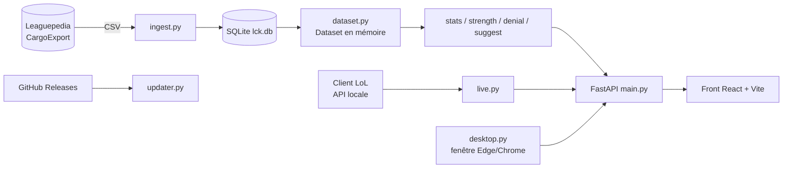
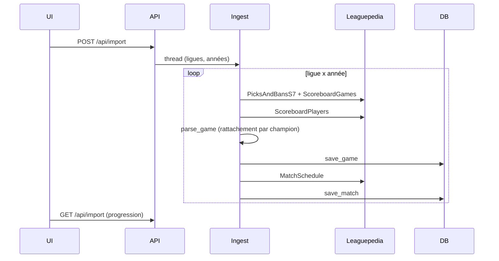
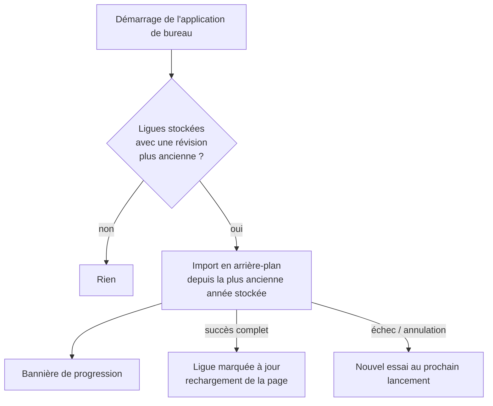

# Architecture

## Vue d'ensemble

## Composants

| Composant | Rôle |
|---|---|
| `backend/app/ingest.py` | Requêtes Cargo paginées, fusion draft + scoreboard, écriture en base |
| `backend/app/db.py` | Schéma SQLite, migrations, écriture des parties |
| `backend/app/dataset.py` | Chargement en mémoire par ensemble de ligues, filtres, comps par côté, détection Fearless |
| `backend/app/stats.py` | Tableaux champions, paires, duos, records, highlights |
| `backend/app/strength.py` | Indice de force et spots |
| `backend/app/denial.py` | Contre de synergie |
| `backend/app/suggest.py` | Suggestions de comp |
| `backend/app/live.py` | Lecture du champ select (LCU), envoi des recommandations |
| `backend/app/importer.py` | Import en arrière-plan piloté par l'interface |
| `backend/app/desktop.py`, `launcher.py`, `runtime.py` | Application de bureau, instance unique, arrêt |
| `backend/app/updater.py` | Mise à jour automatique |
| `frontend/src` | Pages React, client d'API (`api.ts`), filtres globaux (`scope.ts`), routage (`router.ts`) |

## Flux d'import

## Réparation au démarrage

## Déploiement

- Développement : `uvicorn` (port 8000) + Vite (5173).
- Production : PyInstaller (`build.ps1`) embarque le front compilé ; le port préféré est 8765.
- Release : un tag `vX.Y.Z` déclenche le workflow GitHub Actions (tests, build, publication avec SHA-256).

## Décisions

| Décision | Raison |
|---|---|
| Leaguepedia via `Special:CargoExport` | `api.php` est limité en permanence ; Oracle's Elixir sur Google Drive a un quota dépassé |
| Côté de la draft comme référence | L'ordre de draft (première sélection = Blue) n'a de sens que pour la table de drafts |
| Rattachement du scoreboard par champion | Les deux sources peuvent lister les équipes dans l'ordre inverse (voir REQ-DATA-4) |
| Fearless déduit des données | Évite une liste de tournois à maintenir |
| SQLite + chargement mémoire | Application locale mono-utilisateur, analyses en Python |
