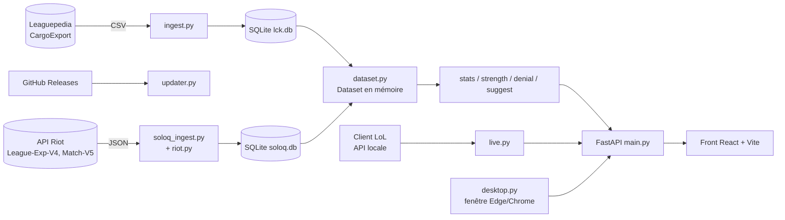
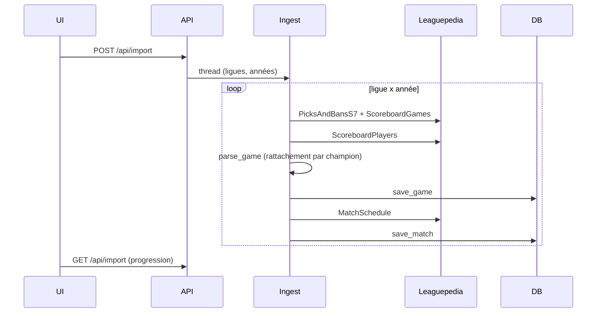
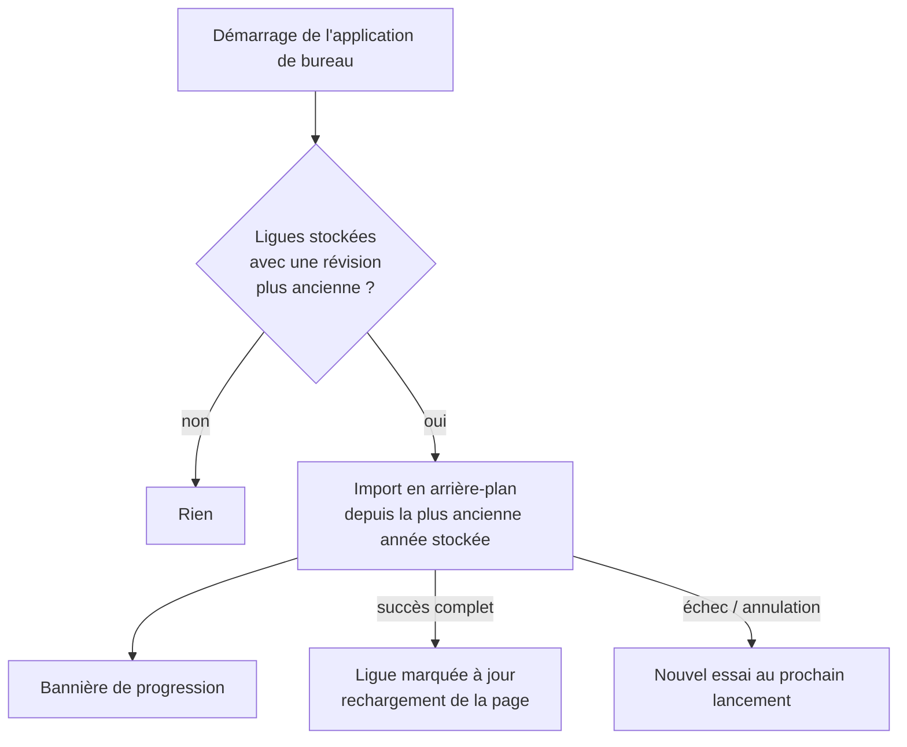
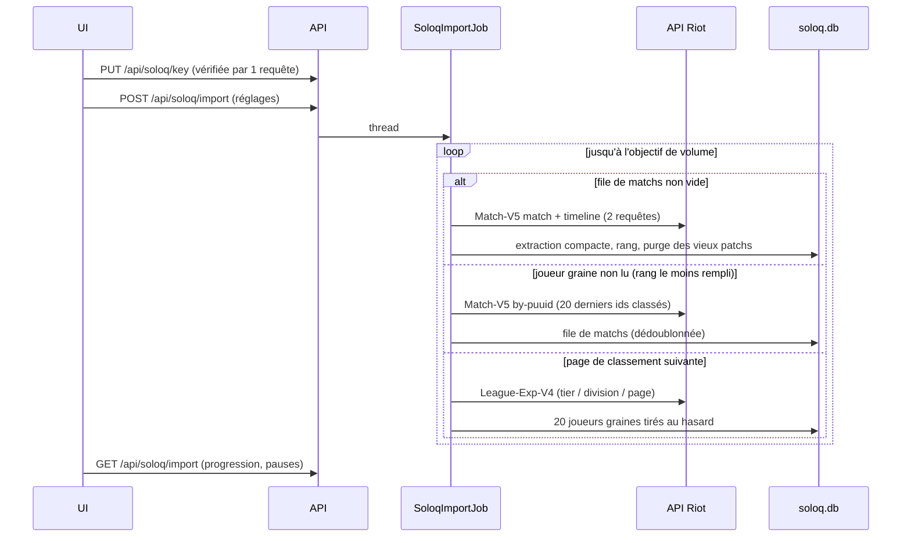

# Architecture

## Vue d'ensemble

## Composants

| Composant | Rôle |
|---|---|
| `backend/app/ingest.py` | Requêtes Cargo paginées, fusion draft + scoreboard, écriture en base |
| `backend/app/db.py` | Schéma SQLite, migrations, écriture des parties |
| `backend/app/dataset.py` | Chargement en mémoire par ensemble de ligues, filtres, comps par côté, détection Fearless |
| `backend/app/stats.py` | Tableaux champions, paires, duos, records, highlights |
| `backend/app/strength.py` | Indice de force et spots |
| `backend/app/denial.py` | Contre de synergie |
| `backend/app/suggest.py` | Suggestions de comp |
| `backend/app/live.py` | Lecture du champ select (LCU), envoi des recommandations |
| `backend/app/importer.py` | Import en arrière-plan piloté par l'interface (Leaguepedia et solo queue) |
| `backend/app/riot.py` | Client de l'API Riot (League-Exp-V4, Summoner-V4, Match-V5), routage plateforme / région, limiteur de débit |
| `backend/app/soloq.py` | Base séparée `soloq.db` : schéma, extraction compacte des matchs et timelines, rétention par patch, chargement en `Dataset` |
| `backend/app/soloq_ingest.py` | Échantillonnage solo queue : classement → joueurs graines → historiques → matchs, dédoublonnage, étiquette de rang |
| `backend/app/config.py` | Dossier de données et réglages locaux (`settings.json` : clé API Riot, options d'import solo queue) |
| `backend/app/desktop.py`, `launcher.py`, `runtime.py` | Application de bureau, instance unique, arrêt |
| `backend/app/updater.py` | Mise à jour automatique |
| `frontend/src` | Pages React, client d'API (`api.ts`), filtres globaux (`scope.ts`), routage (`router.ts`) |

## Flux d'import

## Réparation au démarrage

## Import solo queue (API Riot)

Les parties classées solo/duo (file 420) de rang Émeraude et plus sont importées dans une base **séparée**, `soloq.db`, à côté de `lck.db` : la base pro n'est jamais modifiée par cet import.

| Point | Fonctionnement |
|---|---|
| Routage | Plateforme (`euw1`, `kr`, `na1`…) pour les classements et Summoner-V4 ; région (`europe`, `asia`, `americas`, `sea`) pour Match-V5 (`riot.PLATFORMS`) |
| Limite de débit | Un limiteur par hôte (valeur de routage), fenêtres glissantes 20 req/1 s et 100 req/120 s (clé personnelle), ajustées à l'en-tête `X-App-Rate-Limit`. Un 429 bloque l'hôte pendant `Retry-After` (repli exponentiel sans cet en-tête) puis réessaie ; les erreurs 5xx et réseau sont réessayées avec un délai croissant |
| Clé API | Saisie dans la page Données, vérifiée par `/lol/status/v4/platform-data`, stockée **en clair** dans `settings.json` du dossier de données local (jamais dans le dépôt, jamais dans une URL, un message d'erreur ou un journal ; l'interface n'en montre que les 4 derniers caractères). Un 401/403 arrête l'import et marque la clé « expirée ou invalide » (une clé de développement dure 24 h) |
| Reprise | Curseurs de classement, joueurs graines, file de matchs et matchs ignorés sont en base : un import arrêté reprend où il était, sans recharger une partie. Le drapeau `running` (table `soloq_state`) est conservé si l'application se ferme pendant l'import : l'application de bureau le relance au démarrage |
| Étiquette de rang | Match-V5 ne donne pas le rang : une partie porte le tier des joueurs graines dont l'historique la contenait (tier majoritaire, le plus haut en cas d'égalité) |
| Volume et rétention | L'import s'arrête à l'objectif de parties ; seules les parties des N derniers patchs sont gardées, un patch minimal peut être fixé (la timeline d'une partie refusée n'est pas téléchargée) |
| Champions | Les ids de champions sont convertis en noms via Data Dragon (mêmes noms que les données pro) |
| Rechargement | Le jeu de données solo queue est rechargé au plus une fois par minute pendant l'import |

## Déploiement

- Développement : `uvicorn` (port 8000) + Vite (5173).
- Production : PyInstaller (`build.ps1`) embarque le front compilé ; le port préféré est 8765.
- Distribution : le même `LoLProComp.exe` est publié seul (portable) et dans `LoLProComp-Setup.exe` (`build.ps1 -Installer`, Inno Setup 6, script `installer/LoLProComp.iss`). L'installateur est par utilisateur (`PrivilegesRequired=lowest`, dossier `%LOCALAPPDATA%\Programs\LoLProComp`) : l'application peut donc remplacer son exécutable elle-même et la mise à jour automatique fonctionne à l'identique dans les deux modes. Pour fermer une instance en cours, il appelle `/api/quit` comme le ferait un lancement plus récent, puis laisse le Restart Manager de Windows fermer ce qui reste (l'application n'a pas de mutex nommé : l'instance unique passe par le port 8765).
- Release : un tag `vX.Y.Z` déclenche le workflow GitHub Actions (tests, build de l'exécutable et de l'installateur, publication avec SHA-256).

## Décisions

| Décision | Raison |
|---|---|
| Leaguepedia via `Special:CargoExport` | `api.php` est limité en permanence ; Oracle's Elixir sur Google Drive a un quota dépassé |
| Côté de la draft comme référence | L'ordre de draft (première sélection = Blue) n'a de sens que pour la table de drafts |
| Rattachement du scoreboard par champion | Les deux sources peuvent lister les équipes dans l'ordre inverse (voir REQ-DATA-4) |
| Fearless déduit des données | Évite une liste de tournois à maintenir |
| SQLite + chargement mémoire | Application locale mono-utilisateur, analyses en Python |
| Solo queue dans une base séparée et compacte | `lck.db` reste intact ; le JSON brut (≈ 1 Mo par partie avec la timeline) n'est jamais gardé, seulement quelques Ko de statistiques et de blobs compressés |
| Solo queue dans le même `Dataset` | Toutes les pages (champions, paires, duos, records, suggestions) fonctionnent sans code spécifique ; les notions pro sans objet sont neutralisées (voir [Modèle de données](data-model.md#solo-queue-soloqdb)) |
