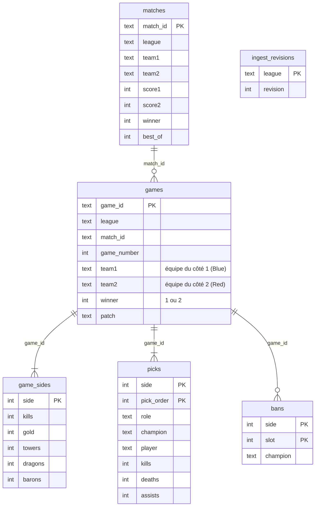

# Modèle de données

Source de vérité : [db.py](../backend/app/db.py) (`SCHEMA`, `SCHEMA_VERSION`).

## Invariants

1. **Côté 1 = Blue = `games.team1`**, côté 2 = Red = `games.team2`. `games.winner` vaut 1 ou 2 selon ce même repère.
2. `matches.team1/team2` suit l'ordre du calendrier, **pas** le côté joué : il peut différer de `games.team1` d'une partie à l'autre (alternance des côtés). Ne jamais comparer les deux par position ; comparer par nom.
3. Pour un `(game_id, side)`, `picks.player` et les statistiques individuelles et de côté (`game_sides`) appartiennent à l'équipe `games.team{side}` (REQ-DATA-4).
4. 5 picks et 5 rôles distincts par côté ; 0 à 5 bans par côté.
5. Les équipes sont normalisées par `teams.canonical` au chargement (franchises coréennes).

## Ordre de draft

`dataset.PICK_SLOT` et `BAN_SLOT` donnent, par côté, la position de chaque pick (1-10) et ban (1-10) dans la draft. Le côté 1 a la première sélection et le premier ban.

## Règles d'ingestion (`ingest.parse_game`)

| Étape | Règle |
|---|---|
| Draft | Picks, rôles et bans lus depuis `PicksAndBansS7` (`Team{1,2}Pick{i}`, `Team{1,2}Role{i}`, `Team{1,2}Ban{i}`) |
| Rôle | Rôle de la draft, sinon déduit de `PicksByRoleOrder` |
| Scoreboard | `_scoreboard_sides` associe chaque côté de draft au côté de scoreboard qui a joué ses champions (vote majoritaire) ; repli sur le même numéro si rien ne correspond |
| Joueurs | `ScoreboardPlayers[(côté scoreboard, rôle)]` : joueur, K/D/A, or, CS, dégâts, vision |
| Stats de côté | `ScoreboardGames.Team{côté scoreboard}{Kills,Gold,Towers,Dragons,Barons}` |
| Rejet | Draft incomplète ou rôles non uniques : partie ignorée et comptée dans « skipped » |

## Migration des données existantes

Un correctif de l'ingestion ne corrige pas les parties déjà en base. La table `ingest_revisions (league, revision)` enregistre, par ligue, la révision des règles d'import sous laquelle ses parties ont été importées ; l'absence de ligne vaut 0. `db.INGEST_REVISION` est la révision courante : **l'incrémenter dès qu'un changement d'ingestion modifie des données déjà stockées** (révision 2 : rattachement du scoreboard par champion).

Au démarrage de l'application de bureau, `importer.start_repair()` ré-importe en arrière-plan les ligues dont la révision est plus ancienne (voir REQ-DATA-8). Les événements internationaux (Worlds, MSI, First Stand) sont détectés par le nom du tournoi, car leurs parties peuvent être rattachées à la ligue organisatrice. En développement, ou en ligne de commande : `python -m app.ingest` (arrêter le serveur pendant l'import).
