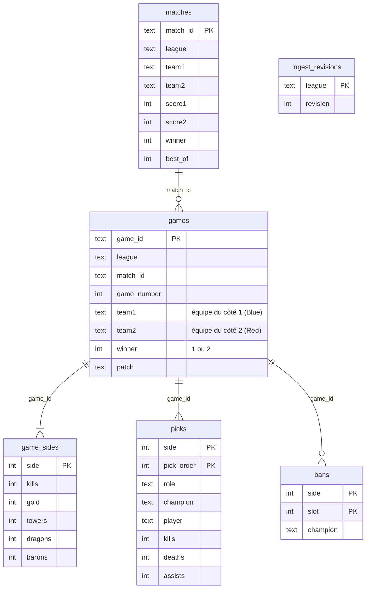
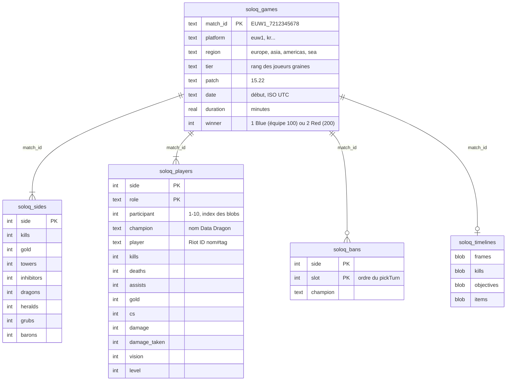

# Modèle de données

Source de vérité : [db.py](../backend/app/db.py) (`SCHEMA`, `SCHEMA_VERSION`).

## Invariants

1. **Côté 1 = Blue = `games.team1`**, côté 2 = Red = `games.team2`. `games.winner` vaut 1 ou 2 selon ce même repère.
2. `matches.team1/team2` suit l'ordre du calendrier, **pas** le côté joué : il peut différer de `games.team1` d'une partie à l'autre (alternance des côtés). Ne jamais comparer les deux par position ; comparer par nom.
3. Pour un `(game_id, side)`, `picks.player` et les statistiques individuelles et de côté (`game_sides`) appartiennent à l'équipe `games.team{side}` (REQ-DATA-4).
4. 5 picks et 5 rôles distincts par côté ; 0 à 5 bans par côté.
5. Les équipes sont normalisées par `teams.canonical` au chargement (franchises coréennes).

## Ordre de draft

`dataset.PICK_SLOT` et `BAN_SLOT` donnent, par côté, la position de chaque pick (1-10) et ban (1-10) dans la draft. Le côté 1 a la première sélection et le premier ban.

## Règles d'ingestion (`ingest.parse_game`)

| Étape | Règle |
|---|---|
| Draft | Picks, rôles et bans lus depuis `PicksAndBansS7` (`Team{1,2}Pick{i}`, `Team{1,2}Role{i}`, `Team{1,2}Ban{i}`) |
| Rôle | Rôle de la draft, sinon déduit de `PicksByRoleOrder` |
| Scoreboard | `_scoreboard_sides` associe chaque côté de draft au côté de scoreboard qui a joué ses champions (vote majoritaire) ; repli sur le même numéro si rien ne correspond |
| Joueurs | `ScoreboardPlayers[(côté scoreboard, rôle)]` : joueur, K/D/A, or, CS, dégâts, vision |
| Stats de côté | `ScoreboardGames.Team{côté scoreboard}{Kills,Gold,Towers,Dragons,Barons}` |
| Rejet | Draft incomplète ou rôles non uniques : partie ignorée et comptée dans « skipped » |

## Migration des données existantes

Un correctif de l'ingestion ne corrige pas les parties déjà en base. La table `ingest_revisions (league, revision)` enregistre, par ligue, la révision des règles d'import sous laquelle ses parties ont été importées ; l'absence de ligne vaut 0. `db.INGEST_REVISION` est la révision courante : **l'incrémenter dès qu'un changement d'ingestion modifie des données déjà stockées** (révision 2 : rattachement du scoreboard par champion).

Au démarrage de l'application de bureau, `importer.start_repair()` ré-importe en arrière-plan les ligues dont la révision est plus ancienne (voir REQ-DATA-8). Les événements internationaux (Worlds, MSI, First Stand) sont détectés par le nom du tournoi, car leurs parties peuvent être rattachées à la ligue organisatrice. En développement, ou en ligne de commande : `python -m app.ingest` (arrêter le serveur pendant l'import).

## Solo queue (`soloq.db`)

Source de vérité : [soloq.py](../backend/app/soloq.py) (`SCHEMA`, `SCHEMA_VERSION`). Base **séparée** de `lck.db`, dans le même dossier de données ; aucune table pro n'y figure et l'import solo queue n'écrit jamais dans `lck.db`. Le JSON brut de l'API Riot n'est **pas** conservé : seules les données ci-dessous sont extraites (quelques Ko par partie, timeline comprise).

Les blobs de `soloq_timelines` sont du JSON compressé par zlib (décodés par `soloq.load_timeline`) :

| Blob | Contenu |
|---|---|
| `frames` | Par minute, pour les participants 1 à 10 : or total, XP, niveau, CS (sbires + jungle), kills, morts, assists cumulés (comptés depuis les événements `CHAMPION_KILL`), dégâts infligés aux champions, dégâts subis (`soloq.FRAME_FIELDS`) |
| `kills` | `[seconde, tueur, victime, [assistants]]` |
| `objectives` | `[seconde, type, côté qui prend l'objectif, détail]` : `tower`, `inhibitor`, `plate` (détail : voie), `dragon` (détail : élément), `herald`, `grub`, `baron`, `atakhan` |
| `items` | `[seconde, participant, action, objet(, objet après)]` : `P` achat, `S` vente, `D` destruction, `U` annulation (`ITEM_UNDO`, avec l'objet avant / après) |

Tables d'état de l'import (reprise après un arrêt ou un redémarrage) :

| Table | Rôle |
|---|---|
| `soloq_ladder (platform, tier, division, next_page, exhausted)` | Curseur de lecture du classement League-Exp-V4 |
| `soloq_seeds (platform, puuid, tier, division, crawled_at)` | Joueurs graines tirés des pages de classement ; `crawled_at` nul tant que leur historique n'est pas lu (relu après 12 h une fois le classement épuisé) |
| `soloq_queue (match_id, platform, tiers, discovered_at)` | Matchs découverts à télécharger ; `tiers` liste le tier de chaque graine qui l'a trouvé |
| `soloq_skipped (match_id, reason)` | Matchs écartés (`remake`, `queue`, `roles`, `patch`, `missing`), jamais redemandés |
| `soloq_state (key, value)` | `running = 1` tant qu'un import est en cours ou interrompu par la fermeture de l'application |

### Règles d'extraction (`soloq.extract_match`, `soloq_ingest.Sampler`)

| Étape | Règle |
|---|---|
| File | Seule la file 420 (classée solo/duo) est gardée |
| Remake | Durée < 5 min ou `gameEndedInEarlySurrender` : partie ignorée |
| Rôle | `teamPosition`, sinon `individualPosition` ; sans 5 rôles distincts par côté, partie ignorée |
| Champion | `championId` converti par Data Dragon (mêmes noms que les données pro, ex. Wukong et non MonkeyKing) |
| Patch | `major.minor` de `gameVersion` ; refusé sous le patch minimal ou s'il serait aussitôt purgé par la rétention (la timeline n'est alors pas téléchargée) |
| Rang | Tier majoritaire des graines qui ont trouvé la partie, le plus haut en cas d'égalité (`soloq.majority_tier`) |
| Serveur | Un id de match d'un autre serveur que celui de la graine (compte transféré) est ignoré |
| Dédoublonnage | Un id déjà stocké, ignoré ou en file n'est jamais retéléchargé |
| Rétention | Après chaque partie, seules les parties des N patchs les plus récents sont gardées (`patches_kept`, 0 = tout) ; les lignes filles sont supprimées en cascade |

### Chargement dans le `Dataset`

Le périmètre `SOLOQ` (jamais combiné aux ligues pro) charge `soloq.db` dans le même `Dataset` que les parties pro, ce qui fait fonctionner toutes les pages. Les notions pro sans objet sont neutralisées :

| Champ | Valeur en solo queue |
|---|---|
| Série | Chaque partie est une série d'une game (`match_id` nul, `game_number` = 1, pas de `matches`) |
| Équipes | `team1` = « Blue », `team2` = « Red » |
| `tournament` | Région de la partie (EUW, KR…) : le filtre des tournois devient un filtre de région |
| Fearless | Toujours désactivé (aucune série de plusieurs games) |
| `rank` | Tier de la partie, filtré par `Filters.ranks` (paramètre `rank`) |
| Ordre de draft | Inconnu (l'API ne donne qu'un `pickTurn` pour les bans) : les picks reçoivent un ordre fictif par rôle. Les statistiques de draft (position de pick, rotation, phase de ban, synergies contrées) n'ont donc pas de sens : l'interface les masque, et les « spots » remplacent série, moment de draft, format et équipe par le rang |
